IV Ingenierías · Estructuras

# Auxiliar IV con RAM Elements

Manual de uso para el equipo: del modelo analizado en RAM a las secciones armadas y la cimentación, pasando por la agrupación de trabes.
**Versión 3.06**Septiembre de 2026
burgos2177-create.github.io/auxiliar-iv Chrome o Edge

## Lo esencial en una página

Si sólo vas a leer una hoja, que sea ésta; el resto del manual explica cada paso.
Una vez por computadora

#### Instalar el catálogo en RAM

1. App: **📥 Reportes de RAM → ⚙ Configurar RAM → ⬇ instalar_catalogo.py**.
2. RAM: **Abrir Script…** → el archivo → `Ctrl`+`R`.
3. Si no aparecen las secciones, cierra y abre RAM.

Una vez por proyecto

#### Conectar la obra

1. **crear-proyectoiv.bat** arma la obra con `PROCESO\Auxiliar IV` y su árbol.
2. App: **⚙ Configurar RAM** → pega la ruta de `PROCESO\Auxiliar IV` → **⬇ Generar sincronizar.py en la carpeta** → elige esa carpeta.

Cada vez que reanalizas

#### Sincronizar

1. RAM: analiza → **Abrir Script… → sincronizar.py → `Ctrl`+`R`**. Escribe `modelo.json` en la carpeta de la obra.
2. App: **🔄 Sincronizar**. Entran las demandas de cada grupo; si hay grupos nuevos, **crear las secciones con su armado**; si hay miembros sin descripción, a **Agrupación**. Las flechas, en **Deflexiones**.

Al estructurar · modelo sin agrupar

#### Agrupar trabes y columnas

1. App: **Módulos → Agrupación**, trabes o columnas. Elige una propuesta o acomódala tú (**✎ a mano**).
2. **⬇ aplicar_agrupacion.py** → en RAM, **Abrir Script… → `Ctrl`+`R`** → reanaliza → sincroniza. Repite una o dos veces: al cambiar secciones cambian los momentos.

> Tres reglas de oro
> 1. **Los scripts se abren, no se pegan.** En la consola de Python de RAM: **Abrir Script…** y `Ctrl`+`R`. Pegados en el editor se descompone la sangría y Python no los entiende.
> 2. **La descripción de RAM es el nombre de la sección.** Un miembro con descripción `T-5` alimenta la sección **T-5** de la app. Cambiar descripciones en RAM es cambiar secciones.
> 3. **La app propone, el ingeniero decide.** Todo lo propuesto (agrupación, secciones, armados) sale verificado con los mismos motores de la app, pero es un punto de partida: se revisa.

### Contenido

- **1**Cómo encaja todo
- **2**Preparar la computadora
- **3**Preparar un proyecto
- **4**El ciclo de todos los días
- **5**Agrupación de trabes
- **6**Acomodar la agrupación a mano
- **7**Agrupación de columnas
- **8**Crear las secciones con su armado
- **9**Revisar y detallar
- **10**Deflexiones
- **11**Cimentaciones
- **12**Los criterios de la app
- **13**Problemas frecuentes
- **14**Práctica con el edificio de prueba
- **15**Referencia rápida

## 1. Cómo encaja todo

RAM analiza; la app diseña. Entre los dos hay unos scripts de Python que corren dentro de RAM y un archivo, `modelo.json`, que los une.
**RAM Elements**El modelo analizado: cada miembro con sección y descripción.
**sincronizar.py**En la consola de Python de RAM: lee geometría, secciones y resultados.
**modelo.json**En la carpeta de la obra. Es lo que la app lee.
**Auxiliar IV**Un grupo por descripción, con demandas y medidas reales.
**Secciones y cimientos**Armado, alzados, cimentación, verificación y memoria.
**La vuelta:** cuando el modelo todavía no está agrupado, el módulo **Agrupación** propone las T (y las C de las columnas), tú eliges o acomodas, y **aplicar_agrupacion.py** les pone su descripción y su sección en RAM. Reanalizas, sincronizas y ya entran como secciones.

### Qué hace cada script

Todos los `.py` los genera la app; no hay que editarlos. Corren dentro de RAM, así que ven el modelo que tengas abierto.

| Script | Qué hace | Qué toca |
|---|---|---|
| **sincronizar.py** | Lee el modelo analizado y lo escribe en `modelo.json`, con las medidas reales de cada sección sacadas de las tablas de RAM, los desplazamientos de las trabes para las flechas, en cada columna P, M22 y M33 simultáneos de cada combinación y las reacciones de los apoyos por caso de carga. | Sólo escribe `modelo.json` en la carpeta de la obra. |
| **instalar_catalogo.py** | Da de alta nuestras secciones, concretos y mampostería para placas en el grupo **Personales** de RAM. | La base de datos de RAM, con respaldo en el Escritorio. |
| **aplicar_agrupacion.py** | Pone a cada miembro la descripción (T1, T2… o C1, C2…) y la sección de la agrupación elegida. | El modelo abierto. Deja un «Deshacer» en `1 Agrupación`. |
| **edificio_prueba.py** | Construye y analiza un edificio de práctica. | Sólo un modelo nuevo y vacío. |

> ¿Por qué no se lee RAM directamente? Un navegador no puede entrar a un programa de Windows, y el Python de RAM no puede abrir ventanas. El archivo `modelo.json` en una carpeta que los dos conocen es el puente: RAM lo escribe, la app lo lee.

### Qué necesitas

- **Chrome o Edge** en la computadora. Son los que dejan a una página leer una carpeta que tú eliges (Firefox y Safari no).
- **RAM Elements** con su **consola de Python**. Los scripts se probaron en RAM Elements 26 (Python 3.13).
- La app: **burgos2177-create.github.io/auxiliar-iv**. Los proyectos se guardan en el navegador y se pueden exportar a archivo.

## 2. Preparar la computadora

Una sola vez por computadora, no por proyecto: el catálogo queda en la base de datos de RAM y lo ve cualquier modelo que abras ahí.

### Instalar el catálogo de secciones, concretos y mampostería

1. En la app, **📥 Reportes de RAM** (arriba a la derecha) → pestaña **⚡ Desde RAM** → abre **⚙ Configurar RAM para este proyecto** → **⬇ instalar_catalogo.py**.
2. En RAM, en la consola de Python: **Abrir Script…** → elige `instalar_catalogo.py` → `Ctrl`+`R`.
3. Lee lo que imprime: cuántas secciones, concretos y materiales de mampostería agregó, cuáles ya estaban y dónde dejó el respaldo.
4. Si no aparecen en el grupo **Personales** al asignar secciones, cierra RAM y vuelve a abrirlo.

#### Secciones de trabe (21)

10 X 25 · 15 X 20 · 15 X 25 · 15 X 30 · 15 X 35 · 15 X 40 · 15 X 45 · 20 X 20 · 20 X 25 · 20 X 30 · 20 X 35 · 20 X 40 · 20 X 45 · 20 X 50 · 25 X 20 · 25 X 25 · 25 X 30 · 25 X 35 · 25 X 40 · 25 X 45 · 25 X 50

#### Secciones de columna (9)

COL 15 X 15 · COL 15 X 20 · COL 15 X 25 · COL 20 X 20 · COL 20 X 25 · COL 25 X 10 · COL 25 X 25 · COL 30 X 30 · COL 36 X 36
Nombre «b X h» en cm, recubrimiento de 3 cm. Las columnas llevan el prefijo **COL** para que no choquen con una trabe de las mismas medidas.

#### Concretos (5)

| Material | f'c | Ec (kg/cm²) | Clase NTC |
|---|---|---|---|
| **F'C 200** | 200 | 113 137 | 2 · 8 000√f'c |
| **F'C 250** | 250 | 221 359 | 1 · 14 000√f'c |
| **F'C 300** | 300 | 242 487 | 1 |
| **F'C 350** | 350 | 261 916 | 1 |
| **F'C 400** | 400 | 280 000 | 1 |

Todos con ν = 0.2, 2.4 t/m³, α = 1×10⁻⁵ /°C, fy = fyt = 4 200 kg/cm², Es = 2.04×10⁶ kg/cm². Clase 1 con agregado calizo (14 000√f'c).

#### Mampostería para placas (4)

| Material | Tabla en Personales | f′m | Em | Gm | ν | Peso |
|---|---|---|---|---|---|---|
| **TABIQUE** barro rojo recocido 7×14×28 | Mampostería de barro | 15 | 9 000 · 600 f′m | 3 600 | 0.25 | 1.5 t/m³ |
| **BLOCK HUECO** concreto 15×20×40, sin colar | Mampostería de concreto | 15 | 12 000 · 800 f′m | 4 800 | 0.25 | 1.4 t/m³ |
| **BLOCK MACIZO** o tabicón | Mampostería de concreto | 15 | 12 000 · 800 f′m | 4 800 | 0.25 | 2.1 t/m³ |
| **COVINTEC** panel 3″ + 2.5 cm de mortero por cara | Mampostería de concreto | 40* | 32 000* | 13 333 | 0.2 | 1.2 t/m³ |

kg/cm². NTC-Mampostería: f′m de diseño sobre área bruta con mortero II o III (con mortero I el block llega a 20), Em para cargas de corta duración, Gm = 0.4 Em; fy = 4 200. El peso es el del muro con sus juntas; el de block macizo es el de Pesos Unitarios. *Covintec no está en la NTC: sus valores son los equivalentes en todo el espesor (12.5 cm) de las dos caras de mortero f′c 100; sirven para el peso y la rigidez del análisis, no para diseñarlo con el módulo de mampostería de RAM. El espesor lo pone la placa.

> La mampostería copia el formato de tu RAM Las tablas de mampostería de RAM llevan otras columnas que la de concreto. El instalador lee las de fábrica (**Masonry clay** y **Masonry concrete**, grupo United States), toma su fila más parecida de plantilla y sólo cambia E, G, ν, peso, α, f′m y fy, ya en las unidades de esa fila; imprime qué columna llenó con qué y cuáles dejó como las trae RAM. Si no encuentra esas tablas no inventa nada: lo dice y lista las que vio (mándale esa salida a quien mantiene la app).

> Es seguro correrlo otra vez El instalador **fusiona**: agrega lo que falta y respeta lo que ya tengas. Antes de escribir deja un respaldo de cada tabla en el Escritorio (`Respaldo RAM - Sections - Personales - …`) y nunca pisa el primer respaldo. Si no puede respaldar, no escribe.

> Los modelos que ya existían Cada modelo guarda su propia copia de los materiales. Si uno viejo trae un F'C 250 con otras propiedades (f'c 281, Fyt de 60 ksi, ν 0.3), corrígelo en ese modelo o reasígnale el del catálogo; instalar el catálogo no cambia modelos ya hechos.

## 3. Preparar un proyecto

Una vez por obra. Todo lo de la app vive en una carpeta, `PROCESO\Auxiliar IV`, con nombres fijos: la app y los scripts saben dónde leer y dónde dejar cada cosa.
**RS-Acacia** ← crear-proyectoiv.bat (RS residencial, NI nave, MZ mezzanine) ├─ RECIBIDO · MONETARIA · ENTREGABLE └─ **PROCESO** └─ **Auxiliar IV** ├─ proyecto.json ← el proyecto de la app (Guardar) ├─ modelo.json ← lo escribe sincronizar.py ├─ sincronizar.py ← lo deja la app, con esta ruta dentro ├─ 1 Agrupación\ ← aplicar_agrupacion y sus «Deshacer» ├─ 2 Salidas\ │ ├─ Memoria\ ← memoria .docx, verificación PDF │ ├─ Planos\ ← DXF, SVG, alzados │ └─ Double Check\ ← .dcheck └─ 3 Respaldos\ ← proyecto y modelo anteriores, con fecha
1. Crea la obra con **crear-proyectoiv.bat** (en `scripts` del repositorio de la app; se corre en la carpeta donde van las obras): elige el tipo, escribe el nombre y arma `RS-Nombre` con sus cuatro carpetas y el árbol de `PROCESO\Auxiliar IV`. El modelo de RAM (.retx) se queda donde lo guardan siempre.
2. En la app abre el proyecto de la obra (o uno nuevo) → **📥 Reportes de RAM** → **⚡ Desde RAM** → **⚙ Configurar RAM para este proyecto**.
3. Copia la ruta de `PROCESO\Auxiliar IV`: en el explorador, `Mayús` + clic derecho sobre la carpeta → **Copiar como ruta**. Pégala en el campo.
4. **⬇ Generar sincronizar.py en la carpeta**: se abre el explorador; elige esa misma carpeta (o `PROCESO`: la app usa, o crea, `Auxiliar IV` adentro) y acepta que la app **edite** archivos ahí. Completa el árbol si falta algo y deja dentro el `sincronizar.py`.
5. Desde entonces la carpeta queda recordada para esta obra: sincronizar es un clic, y **Guardar**, las salidas y los respaldos van solos a su lugar.

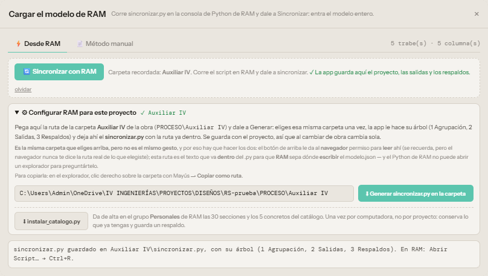
_Figura:_ **Así se ve una obra ya configurada.** La ruta de `PROCESO\Auxiliar IV` pegada y **✓ Auxiliar IV** junto a Configurar; arriba, **Carpeta recordada** y **✓ La app guarda aquí el proyecto, las salidas y los respaldos** (tiene permiso de edición); abajo, el aviso de que `sincronizar.py` quedó en la carpeta con su árbol. Si en lugar del ✓ verde dice «La app sólo la lee», dale a Sincronizar y acepta el permiso de **edición**.

### Qué hace la app con la carpeta

| Cuando… | Queda en |
|---|---|
| 💾 Guardar | `proyecto.json`; el que había pasa a `3 Respaldos\proyecto <fecha>.json`. Si ése era de otra obra, pregunta antes de pisarlo. |
| 🔄 Sincronizar con un modelo nuevo | El `modelo.json` anterior pasa a `3 Respaldos\modelo <fecha>.json`. Al sincronizar no se leen `1 Agrupación`, `2 Salidas` ni `3 Respaldos`. |
| ⬇ aplicar_agrupacion.py | `1 Agrupación\aplicar_agrupacion <fecha>.py`; su «Deshacer» también queda ahí. |
| Memoria, verificación, DXF, SVG, alzados, Double Check | `2 Salidas\Memoria`, `\Planos` y `\Double Check`. |

Se guardan los 30 respaldos más recientes de cada tipo. Un proyecto sin carpeta configurada, o si el navegador no da permiso de edición, descarga como siempre. Chrome o Edge a veces vuelven a pedir el permiso al abrir la app otro día: es un clic.

> ¿Por qué se pega la ruta y además se elige la carpeta? Elegirla le da al **navegador** permiso para leer y escribir ahí, pero el navegador nunca le dice a la página la ruta real. La ruta pegada es el texto que va **dentro** del `sincronizar.py` para que **RAM** sepa dónde escribir, porque el Python de RAM no puede abrir un explorador para preguntarlo.

#### Cuándo volver a generar sincronizar.py

- Si la obra cambia de carpeta (la ruta se guarda con el proyecto: al cambiar de proyecto cambia sola).
- Cuando la app se actualice: el script también mejora (por ejemplo, las medidas reales de las secciones vienen del script nuevo). Si la app dice «medidas deducidas de los nombres», es un script viejo.

Para apuntar la obra a otra carpeta, usa **olvidar** junto al botón de sincronizar y vuelve a elegirla.

> Método manual La pestaña **📄 Método manual** guarda la forma antigua de cargar reportes (archivos de texto exportados de RAM por separado). Sigue funcionando, pero el camino recomendado es **Desde RAM**.

## 4. El ciclo de todos los días

Cambias el modelo, analizas, sincronizas. La app se entera de las demandas nuevas y te avisa de lo que no cuadra.
1. **En RAM, analiza.** El script lee resultados: sin análisis no hay demandas, o son las de antes.
2. **Abrir Script… → sincronizar.py → `Ctrl`+`R`.** Imprime cuántos miembros y grupos leyó, la tabla de secciones con sus medidas reales y dónde dejó el `modelo.json`.
3. **En la app, 🔄 Sincronizar.** Un clic: lee el `modelo.json` de la carpeta y actualiza el proyecto.

### Qué entra

- Un **grupo** por cada descripción de RAM, con todos sus miembros. El grupo `T-5` alimenta la sección **T-5**.
- Las **demandas** de cada miembro por estaciones, con los picos exactos: momentos positivo y negativo, cortante y carga axial.
- En cada **columna**, las fuerzas **simultáneas** de cada combinación en su pie y en su cabeza: P, M22 y M33 de la misma combinación, que es lo que pide el diagrama de interacción. Con ellas revisan el módulo Columnas y la agrupación de columnas.
- Las **medidas reales** de cada sección (b, h y recubrimiento) leídas de las tablas de RAM, no del nombre.
- La geometría: nudos y miembros, para encadenar tramos en trabes continuas y dibujar el modelo.
- En cada trabe, el **desplazamiento vertical y el momento por caso de carga** (CM, CV…, sin sismo), para **Deflexiones**. El script comprueba la unidad de los desplazamientos con los giros de RAM.

### Los avisos, y qué hacer con cada uno

#### Grupos que el proyecto todavía no tiene

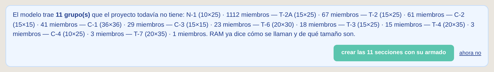
**crear las N secciones con su armado** las da de alta con las medidas de RAM y un armado propuesto (capítulo 8). **ahora no** las deja para después.

#### Las demandas son de otra sección

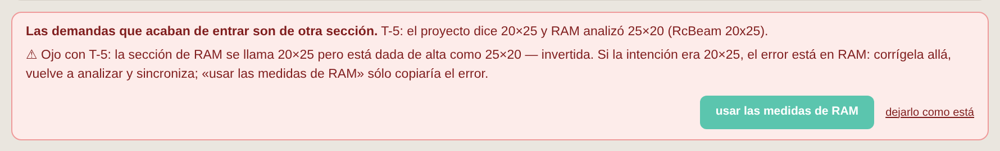
El proyecto dice una sección y RAM analizó otra. Si el cambio fue a propósito en RAM, **usar las medidas de RAM**. Si RAM está mal (como aquí, una sección que se llama 20×25 pero está dada de alta como 25×20), corrígela allá, reanaliza y sincroniza: copiar las medidas sólo copiaría el error.

#### Miembros sin descripción

No se crea una sección con ellos: todavía no están agrupados. Ve a **Módulos → Agrupación** (capítulos 5 a 7).

## 5. Agrupación de trabes

Al estructurar, todas las trabes suelen ser 15×20 y sin descripción. La agrupación propone unas pocas T, cada una con su sección, para iterar con un modelo estable y rigideces bien repartidas, con los menos diseños posibles.

> La idea Una T puede estar en varios niveles: lo que importa es que sus trabes pidan parecido. Entre más desbalanceadas estén las demandas, más grupos hacen falta para no desperdiciar concreto. Por eso hay tres propuestas, de pocos grupos a ajustada, y además el acomodo a mano.

Se abre en **Módulos → Agrupación** (o `Ctrl`+`K` y «agrupación»). Toma sola el último modelo sincronizado; también puedes cargar un `modelo.json`. Arriba del paso 1 está el interruptor **Trabes | Columnas**: este capítulo y el siguiente son de trabes; las columnas, en el capítulo 7.

### Paso 1 · Qué agrupar

Cada casilla es un grupo de hoy (una descripción de RAM, o **(sin nombre)**). Vienen marcadas las trabes de 15 cm o más; las nervaduras y las columnas no. Abajo, los **anchos** y los **peraltes que se pueden proponer**: el ancho suele mandarlo el muro o la columna y el peralte la arquitectura (plafones, ventanas, altura libre). **tope** marca de un golpe todos los peraltes hasta ése. Con un tope, la propuesta compensa con más ancho si lo permites; si una trabe no cabe en ninguna sección permitida, su grupo se marca ⚠ y la verificación dice si se puede armar con más acero. La app recuerda lo que marcaste.

### Paso 2 · Las propuestas

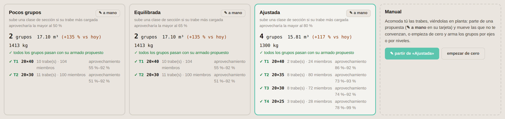
Cómo se arman:
1. Los tramos colineales y seguidos se encadenan en **trabes continuas**: una trabe continua es una sola sección.
2. A cada trabe su **sección mínima**: la de menos concreto del catálogo que da el momento con una cuantía cómoda y el cortante con estribos que se pueden armar (criterios en el capítulo 12).
3. Las trabes con la misma sección mínima forman una clase. De la más grande a la más chica, una clase **sube** a la sección del grupo de arriba si cabe y si su trabe más cargada la aprovecharía al menos al umbral: **Pocos grupos 50 %**, **Equilibrada 65 %**, **Ajustada 80 %**. Umbral más bajo, menos grupos y más concreto.
4. Cada grupo pasa por el mismo motor que arma las secciones (capítulo 8): si sale **✓**, se puede armar con esa sección.

Cómo leer una tarjeta: número de grupos; **m³** de concreto en trabes y su cambio contra hoy (si hoy todo es 15×20, crece: es lo esperado); **kg** de acero del armado propuesto; y por grupo su sección y el rango de **aprovechamiento** de sus trabes (100 % = justo). Un rango muy abierto, como 30–95 %, quiere decir que hay trabes ligeras pagando la sección de las pesadas.

### Paso 3 · Verla en planta

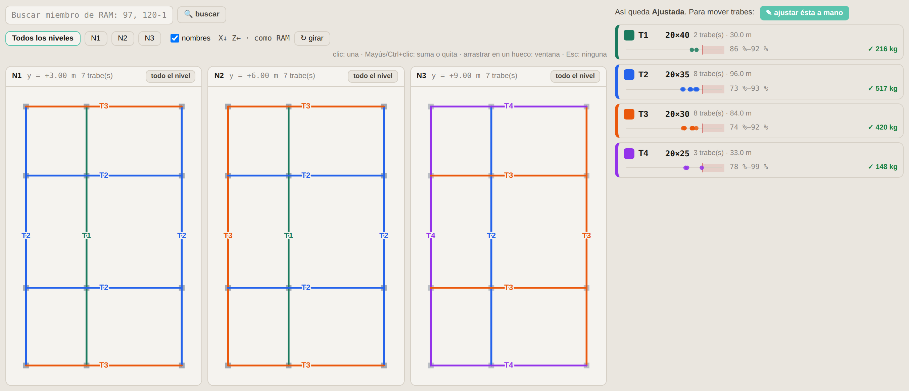
La propuesta elegida se dibuja por nivel, cada grupo de su color, con las columnas en gris. Al pasar el mouse sobre una trabe se ven su longitud, sus demandas, la sección que le basta y qué tanto aprovecha la de su grupo. Una línea **punteada roja** encima es una trabe que no cabe en la sección de su grupo.

> Orientación: como RAM La planta es la vista desde arriba del mismo lado que la vista de RAM con Y vertical: **Z hacia la izquierda y X hacia abajo** (dice `X↓ Z← · como RAM`). Con **↻ girar** se gira por cuartos de vuelta; nunca sale en espejo. La app recuerda cómo la dejaste.

### Paso 4 · Aplicarla en RAM

1. **⬇ aplicar_agrupacion.py** baja el script con la propuesta elegida (o tu acomodo manual) dentro.
2. En RAM, con el modelo abierto: **Abrir Script… → `Ctrl`+`R`**. Primero comprueba que todas las secciones existan (si falta una no cambia nada y te pide el catálogo), deja en `1 Agrupación` un `Deshacer agrupación <fecha>.py` (en el Escritorio si la obra no tiene carpeta) y luego pone a cada miembro su descripción y su sección.
3. **Reanaliza y sincroniza.** Ahora los miembros llegan con descripción: la app ofrece crear las T como secciones.

> Es una iteración, no la última palabra Las demandas son las del análisis con las secciones de **hoy**. Al cambiar secciones cambian las rigideces y con ellas los momentos. Aplica, reanaliza y vuelve a abrir Agrupación: si los grupos siguen pasando, listo; si no, ajusta. Normalmente bastan una o dos vueltas.

**Si algo no convence:** cierra el modelo sin guardar y no pasó nada, o corre el **Deshacer** de `1 Agrupación`, que regresa cada miembro a la descripción y la sección que tenía.

## 6. Acomodar la agrupación a mano

Cuando el criterio fino es tuyo: acomodar por ejes o por niveles, juntar lo que se va a construir igual o fijar un peralte que pide la arquitectura. Se hace en la app, no en RAM, y sale el mismo `aplicar_agrupacion.py`.

### Empezar

- **✎ a mano** en cualquier tarjeta copia esa propuesta al acomodo manual para moverle lo que no te convenza.
- **empezar de cero** deja todas las trabes sin asignar para armar los grupos tú.

El acomodo aparece como cuarta tarjeta, **Manual**, con sus números y su verificación como las otras, y se edita en el paso 3.
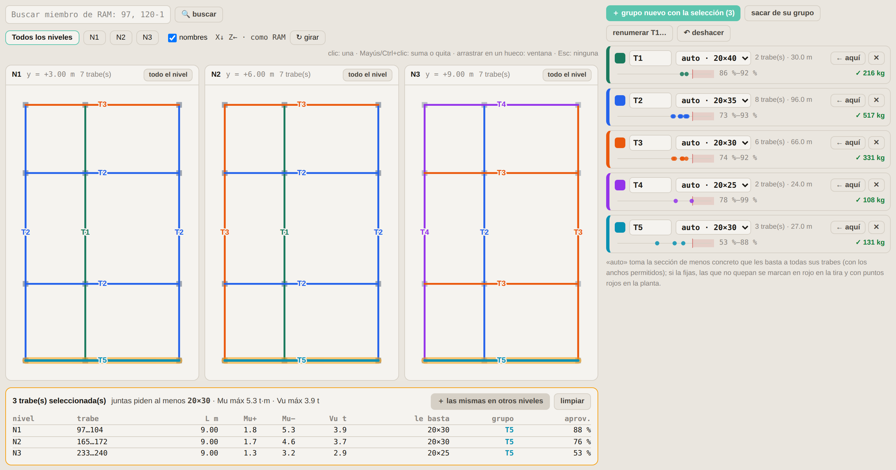
_Figura:_ **Acomodo manual.** Se tomó la trabe de fachada del nivel 1 con sus iguales de los otros niveles («las mismas en otros niveles») y se hizo un grupo nuevo, T5. La tabla de abajo es la selección.

### La escala de aprovechamiento

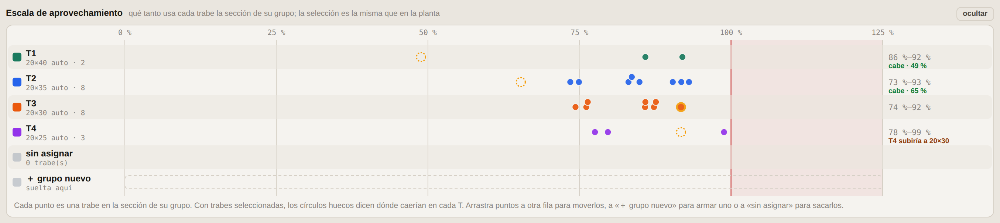
_Figura:_ **Escala de aprovechamiento.** Se seleccionó la trabe más cargada de T3 (anillo naranja). Los círculos huecos dicen dónde caería en cada otra T: en T1 y T2 cabe (49 y 65 %); en T4, que es automática, la haría crecer a 20×30.
Arriba de la planta, una fila por grupo y un punto por trabe, en el aprovechamiento de la sección de su grupo: como la escala de momentos de Secciones, pero para toda la agrupación. Los puntos juntos y a la derecha son un grupo bien aprovechado; los que quedan solos a la izquierda son trabes que pagan una sección que no necesitan.
- **Seleccionar:** clic en un punto, `Mayús`/`Ctrl`+clic para sumar, o arrastrar en un hueco para seleccionar por ventana. La selección es la misma que en la planta y en la tabla.
- **Probar antes de mover:** con trabes seleccionadas, cada otra fila muestra en círculos huecos dónde caerían y dice si **caben**, si la T **subiría** de sección (si es automática) o si **no caben** (si la sección está fija).
- **Mover:** en el acomodo manual, arrastra los puntos a otra fila. Mientras arrastras, la fila de destino se resalta y muestra dónde quedarían. Soltarlos en **＋ grupo nuevo** arma un grupo con ellos; en **sin asignar**, los saca. Todo se deshace con **↶ deshacer**.
- En una propuesta automática se ve y se selecciona, pero para mover hay que pasarla a mano (**✎ ajustar ésta a mano**).

### Seleccionar trabes

| Gesto | Qué hace |
|---|---|
| **Buscar miembro de RAM** (arriba de la planta) | Escribe el número de miembro de RAM (varios con coma, o un rango `120-124`) y `Enter`: selecciona la trabe continua donde está, la muestra en su nivel y la hace parpadear. `Mayús`+`Enter` la suma a la selección. Si no la encuentra dice por qué: no existe, es columna o su grupo no está marcado en «Qué agrupar». |
| Clic en una trabe | La selecciona (sólo ésa). Al pasar el mouse se ven sus números de miembro. |
| `Mayús` o `Ctrl` + clic | La agrega o la quita de la selección. |
| Arrastrar en un hueco | Selección por ventana: las trabes cuyo tramo cae dentro. Con `Mayús`, se suman. |
| **todo el nivel** | Todas las trabes de ese nivel. |
| **＋ las mismas en otros niveles** | Agrega las trabes que están en el mismo lugar en planta en los demás niveles: la misma trabe en N1, N2, N3… |
| Clic en el cuadro de color de un grupo | Selecciona sus trabes. |
| `Esc` o **limpiar** | Ninguna. |

Con trabes seleccionadas aparece la tabla: nivel, longitud, Mu+, Mu−, Vu, la sección que le basta a cada una, su grupo y cuánto lo aprovecha. Arriba dice qué sección piden **juntas**: si armaras un grupo sólo con ellas, ésa sería su sección.

### Acomodar

| Botón | Qué hace |
|---|---|
| **← aquí** (en un grupo) | Mueve las trabes seleccionadas a ese grupo. |
| **＋ grupo nuevo con la selección** | Crea el siguiente T libre con esas trabes. |
| **sacar de su grupo** | Las deja sin asignar. Al aplicar, en RAM no se tocan. |
| **✕** (en un grupo) | Quita el grupo; sus trabes quedan sin asignar. |
| Nombre del grupo | Se escribe libre (T1, TR-2, TE…) y se guarda al salir del campo o con `Enter`. Es la descripción que tendrá en RAM. |
| Sección: **auto** o fija | **auto** toma la de menos concreto que les basta a todas sus trabes, con los anchos permitidos. Si eliges una del catálogo queda fija, y las trabes que no quepan se marcan. |
| **renumerar T1…** | Renombra T1 a la sección más grande … Tn a la más chica, como las propuestas. |
| **↶ deshacer** | Regresa el último cambio (hasta 60). |

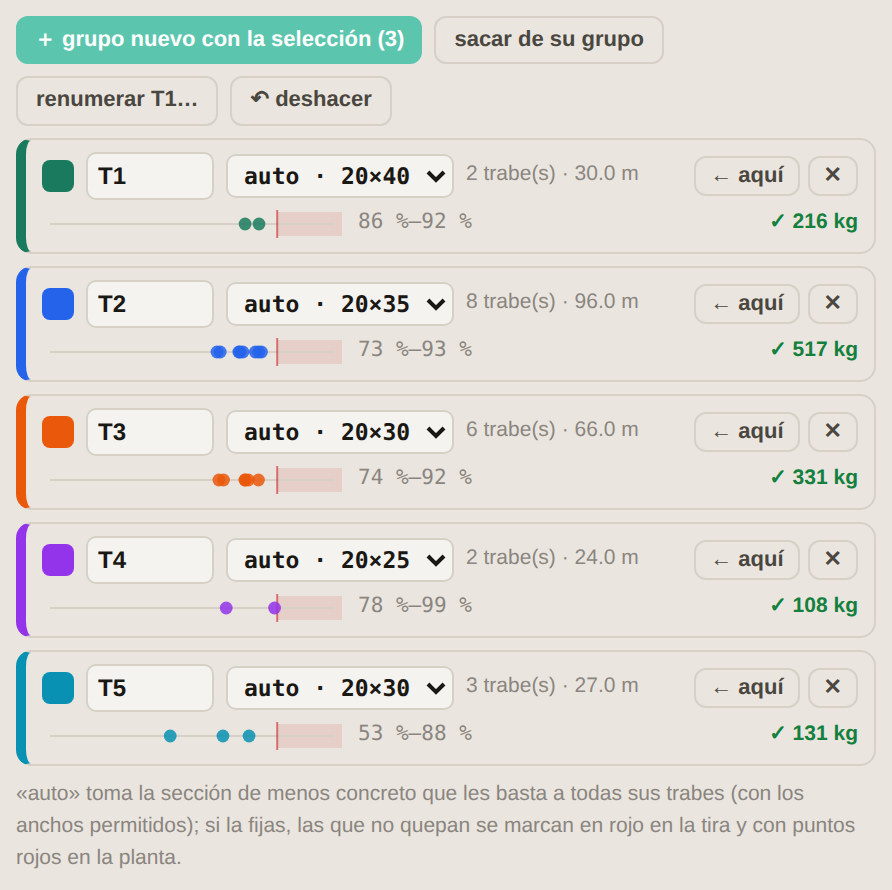
_Figura:_ **Los grupos.** La tira muestra un punto por trabe según cuánto aprovecha la sección del grupo; la zona rosa es más de 100 %. A la derecha, el acero del armado propuesto con ✓ si pasa.

> Criterio para acomodar
> - Una tira con los puntos juntos y a la derecha (70–95 %) es un grupo bien aprovechado. Puntos muy a la izquierda son trabes que podrían ir en un grupo más chico.
> - Juntar lo que se construye igual (la misma trabe en todos los niveles, los ejes de fachada) ahorra diseños y errores en obra aunque cueste un poco de concreto.
> - Fija la sección cuando la arquitectura manda el peralte; la tira te dice de inmediato qué trabe no cabe.

### Guardar, aplicar y descartar

- El acomodo se guarda en el navegador: si cierras la app o recargas, al volver con el mismo modelo sigue ahí. Después de aplicar y reanalizar también se conserva, y lo ves con las demandas nuevas.
- La app no deja aplicar si hay un grupo sin nombre, un nombre repetido o un nombre que ya usa en el modelo un grupo que no se está agrupando (se mezclarían en RAM).
- **✕ descartar** en la tarjeta Manual lo tira.

## 7. Agrupación de columnas

El mismo agrupador, con flexocompresión: cada columna se ubica en el diagrama de interacción de cada sección del catálogo y se juntan las que caben en la misma. Se elige con el interruptor **Columnas**, arriba del paso 1.
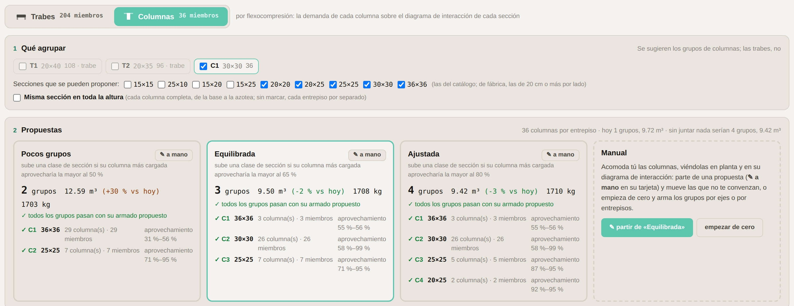
_Figura:_ **Agrupación → Columnas** con el edificio de prueba, por entrepiso. En **Equilibrada**, C1 de 36×36 para las tres columnas más cargadas, C2 de 30×30 y C3 de 25×25 en el último entrepiso; la Fase 1 arma y verifica los tres grupos.

> Necesita el sincronizar.py actual Uno anterior guardaba de cada columna el P máximo y el M33 máximo por separado, y sin M22: no sirve para flexocompresión. Si el `modelo.json` es de antes, la app lo avisa en el paso 1. Genera el script otra vez (capítulo 3), córrelo en RAM y sincroniza.

### Paso 1 · Qué agrupar

- Vienen marcados los grupos de columnas (los que tienen miembros verticales); las trabes, no.
- **Secciones que se pueden proponer:** las columnas del catálogo. De fábrica, las de 20 cm o más por lado; las de 15 cm son castillos y se marcan a mano si las quieres.
- **Misma sección en toda la altura:** cada columna completa, de la base a la azotea, es un solo elemento con la demanda de su entrepiso más cargado. Sin marcar, cada entrepiso va por separado (E1 es el de abajo) y la sección puede bajar hacia arriba.

### Cómo se mide el aprovechamiento

1. Cada sección del catálogo tiene su **diagrama de interacción** con un armado de referencia: el de menos varillas con cuantía entre 1.5 y 2.5 % (8#5 en 30×30, 4#6 en 25×25, 8#6 en 36×36). Es un armado cómodo; el de cada grupo lo pone después la Fase 1.
2. Cada combinación en el pie y en la cabeza de una columna es un **punto** (P, Mx, My): Mx = |M33| trabaja el peralte h y My = |M22| el ancho b, como en el módulo Columnas, y los dos se revisan juntos con el contorno biaxial.
3. El **aprovechamiento** de un punto es qué tanto habría que crecer su P y sus momentos, juntos y en la misma proporción, para tocar la frontera: 100 % es justo en el diagrama; 50 % es que aguantaría el doble. El de la columna es el de su punto más exigido.
4. De ahí en adelante es igual que con las trabes: la sección mínima de cada columna, las clases, los tres umbrales (50, 65 y 80 %) y los grupos **C1, C2…** de la sección más grande a la más chica. Cada grupo lo arma la Fase 1 con el motor del módulo Columnas (capítulo 8).

### La planta y el acomodo a mano

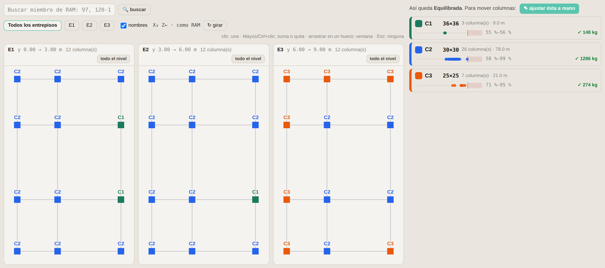
_Figura:_ **Las columnas en planta,** un cuadro de su color por entrepiso, sobre las trabes del nivel en gris. A la derecha, los grupos con su tira de aprovechamiento y el acero de la Fase 1.
Todo lo del capítulo 6 funciona igual: la escala de aprovechamiento, seleccionar en la planta o en la escala, arrastrar a otro grupo o a **＋ grupo nuevo**, fijar la sección, **renumerar C1…**, buscar un miembro de RAM y deshacer. **＋ la misma en otros entrepisos** agrega la columna de arriba y la de abajo. Con la sección fija, una columna que no cabe se ve con borde rojo.
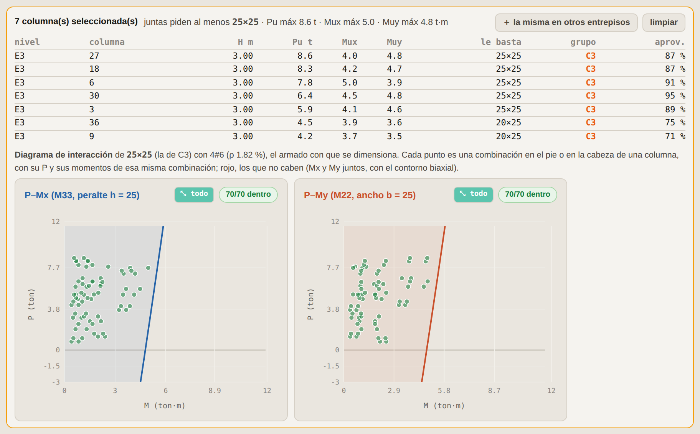
_Figura:_ **El diagrama de interacción de la selección.** Se seleccionaron las columnas de C3: sus 70 puntos (7 columnas × 5 combinaciones × pie y cabeza) sobre el diagrama de 25×25 con 4#6. **⤢ demanda** / **⤡ todo** acerca o aleja.
Con columnas seleccionadas aparece su diagrama, en X y en Y: el de la sección de su grupo si todas están en uno, o el de la sección que piden juntas. Verde, los puntos que caben; rojo, los que no. X e Y se dibujan por separado pero se revisan juntos, así que un punto que en cada dibujo parece holgado puede estar cerca del 100 %: el número que manda es el de la tabla. Al pasar el mouse sobre una columna se ve qué combinación y qué extremo la rigen.

### Aplicar

**⬇ aplicar_agrupacion.py** baja `aplicar_agrupacion columnas <fecha>.py`, con cada C y su sección `COL …`. Trabes y columnas se aplican por separado, cada una con su script y su Deshacer, en el orden que quieras. Luego, como siempre: reanaliza, sincroniza y vuelve a abrir Agrupación.

> Lo que no revisa Esbeltez (efectos de segundo orden) ni cortante de columnas: la agrupación y la Fase 1 revisan flexocompresión con las fuerzas del análisis.

## 8. Crear las secciones con su armado

Cuando la sincronización trae grupos nuevos, la app los da de alta con las medidas de RAM y un armado propuesto, verificado con los mismos motores que Longitudinal y Columnas.
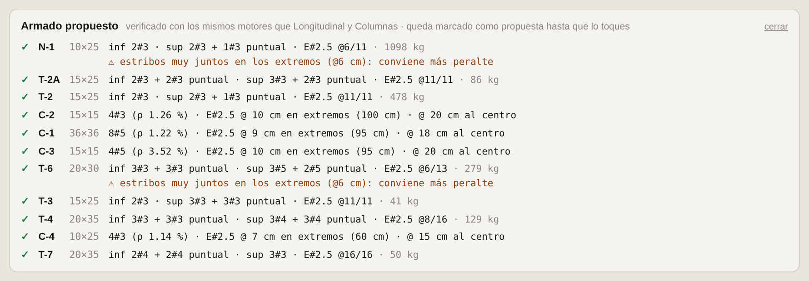
_Figura:_ **Armado propuesto** después de «crear las secciones con su armado».
- **✓** pasa con ese armado. **✗** no se encontró uno que pase con esa sección: hace falta más sección.
- **⚠** pasa, pero con un aviso; el más común es «estribos muy juntos en los extremos: conviene más peralte».
- El armado queda marcado **como propuesta** hasta que lo toques: cualquier cambio tuyo quita la marca, y a partir de ahí es tuyo.

### Trabes

Varillas corridas arriba y abajo con el mínimo que da el momento, bastones o puntuales donde hacen falta y estribos #2.5 (o #3) de dos ramas con su separación en L/4 y al centro. El número de varillas corridas por lecho se limita por el ancho para que se pueda colar: hasta 3 en 25 cm, 4 en 35 cm, 5 en más.

### Columnas

El arreglo con menos varillas que pasa, con cuantía entre 1 y 4 %, separación centro a centro no mayor de 20 cm y varilla #4 o mayor si un lado mide 20 cm o más. Los estribos salen por zonas con la altura del modelo (capítulo 9).
La envolvente de una columna son sus combinaciones con P, M22 y M33 simultáneos, en el pie y en la cabeza de cada miembro. El módulo Columnas las dibuja y las revisa todas; los informes listan la que rige de cada miembro.

> Revisa siempre La propuesta es un buen punto de partida, no un diseño terminado: revisa detalles, anclajes y lo que tu criterio pida. Los ✗ y ⚠ son lo primero.

## 9. Revisar y detallar

Con las secciones creadas, el trabajo es el de siempre, ahora con las demandas del modelo ya dentro.

### Longitudinal

**Módulos → Longitudinal.** El alzado de cada trabe contra las demandas del modelo por estaciones: dónde hacen falta bastones y la envolvente desarrollada. Ahí también se ve el modelo reconstruido (planta, frente, lado e isométrica) para ubicar una trabe o comprobar que los tramos se encadenaron como esperas. La planta está orientada como RAM: Z a la izquierda y X hacia abajo.

### Columnas: estribos por zonas

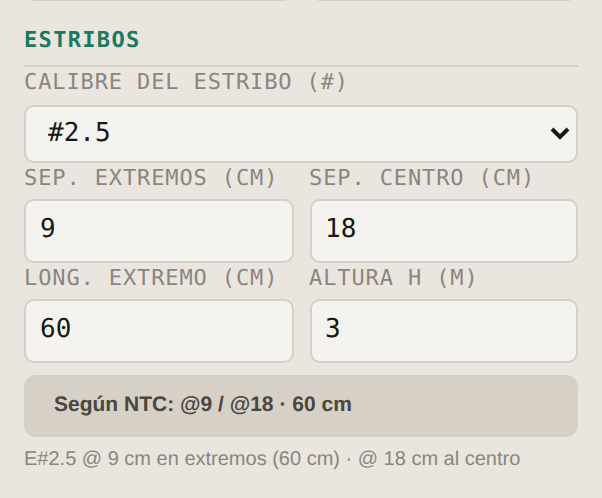
En la columna: calibre del estribo, separación en los **extremos** y al **centro**, longitud de la zona extrema y altura libre H. **Según NTC** llena las tres con las reglas de abajo; puedes cambiarlas a mano.
- **Centro:** s ≤ el menor de 850/√fy · db (varilla longitudinal), 48 · db (estribo) y la mitad del lado menor.
- **Extremos:** la mitad, en una longitud no menor que el lado mayor, H/6 y 60 cm.
- **Castillos** (lado menor de 20 cm): al centro el menor de 1.5 t y 20 cm (NTC-Mampostería); en los extremos la mitad, por criterio IV.

Los informes, el dibujo y la memoria dicen las dos separaciones. Una columna sin zonas se sigue informando como antes.

### Verificar y entregar

- **Verificar → Resumido / Detallado**: el estado de todas las secciones.
- **Verificar → Memoria de cálculo** y **Exportar a Double Check** para la revisión cruzada.
- **Exportar DXF** o **SVG** para los planos.

### La memoria se llena sola

Al abrir **Memoria de cálculo**, los datos que la app ya conoce llegan escritos, y bajo cada uno dice de dónde salió:
- **Del modelo de RAM:** niveles (los que tienen trabes arriba del desplante), altura de entrepiso (la más común) y un área aproximada (el rectángulo de cada nivel).
- **De Pesos Unitarios:** CM de losa (la de entrepiso más pesada), CM de muro, CV de entrepiso y de azotea, y el área de los tableros, que manda sobre la del modelo.

Sólo se llenan los campos vacíos o que siguen con su valor de fábrica: lo que escribiste no se toca. **↻ Llenar con Pesos Unitarios y el modelo** los vuelve a tomar. Si el proyecto tiene cimientos, el Word trae su capítulo (capítulo 11).
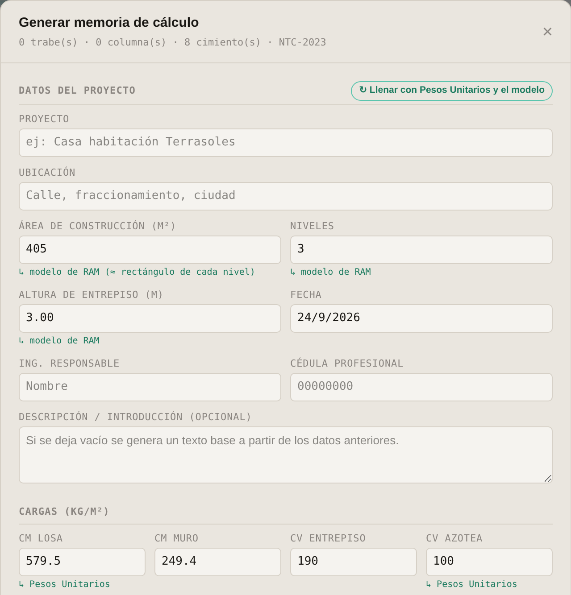

## 10. Deflexiones

Las flechas de todas las trabes, con los desplazamientos que calcula RAM, corregidos con la inercia agrietada del armado de cada sección y con las diferidas, contra los límites de la NTC.
1. Sincroniza con un `sincronizar.py` actual: es el que lee los desplazamientos. Si la app dice que el `modelo.json` no los trae, genera el script otra vez (capítulo 3).
2. Crea las secciones de las trabes (capítulo 8): sin armado no hay inercia agrietada, y esos tramos se muestran con la flecha elástica de RAM, marcados **? sin armado**.
3. **Módulos → Deflexiones.** Revisa que arriba diga `CS = 1·CM + 1·CV` (si tu modelo nombra distinto los casos, cambia su papel); la tabla se ordena del tramo más comprometido al menos.

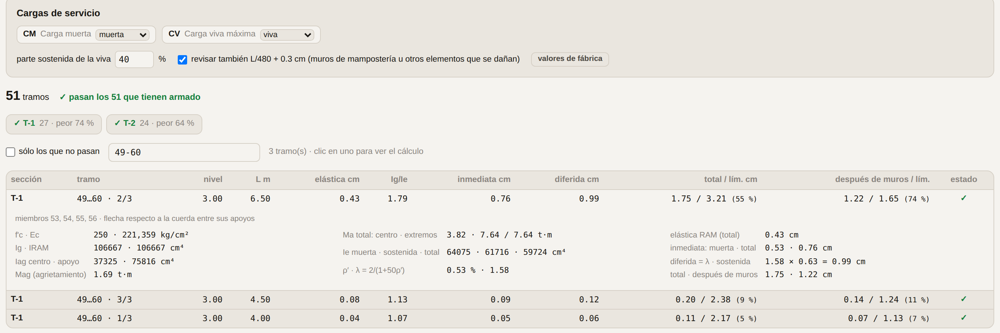
_Figura:_ **Deflexiones.** La carga de servicio CS = 1·CM + 1·CV, los tramos de la trabe que tiene el miembro 49 y, abierto, el cálculo del claro de 6.50 m: elástica de RAM 0.43 cm, agrietada 0.76, diferida 1.21, total 1.97 de 3.21 cm; después de los muros 1.44 de 1.65 cm.

### Qué hace

- **Cargas:** las de servicio, **CS = 1·CM + 1·CV**, para la inmediata y también como carga sostenida para la diferida.
- **Tramos:** cada trabe continua se parte entre apoyos (nudos con columna o con apoyo, y extremos que se conectan a algo). Un extremo libre es un **voladizo**.
- **Flecha relativa:** contra la cuerda entre los apoyos del tramo (en voladizos, contra su apoyo). Lo que se acortan las columnas no es flecha de la trabe.
- **Inmediata:** la elástica de RAM × I_RAM/I_e. I_e de Branson con la sección agrietada y el armado del proyecto (corridas y puntuales: abajo al centro, arriba en los apoyos); en tramos continuos I_e = (I_e1 + I_e2 + 2I_e3)/4. Se calcula con la carga muerta y con CS.
- **Diferida:** λ × inmediata de la carga sostenida (CS), λ = 2/(1 + 50ρ′) en concreto clase 1 (4/(1 + 50ρ′) en clase 2).
- **Límites:L/240 + 0.5 cm** con todo (inmediata con CS + diferida) y, si hay muros de mampostería u otros elementos que se dañan, **L/480 + 0.3 cm** con lo que pasa después de colocarlos (inmediata de la viva + diferida). En voladizos, el doble.

### Qué configurar

| Opción | Qué es |
|---|---|
| Papel de cada caso | **muerta**, **viva**, **viva media** o **no usar**. Sale de la categoría del caso en RAM (CM muerta, CV viva; la accidental y la media no); cámbialo si tu modelo los llama distinto. Arriba se ve la combinación que resulta: `CS = 1·CM + 1·CV`. |
| Viva sostenida en la diferida | 100 % de fábrica: la sostenida es CS completa. Se puede bajar, o marcar un caso como **viva media** para que la diferida use ése. |
| Revisar L/480 + 0.3 cm | Activado de fábrica. Apágalo si las trabes no cargan elementos que se dañen con la flecha. |

Filtros: por sección (los botones con su peor porcentaje), **sólo los que no pasan** y por miembro de RAM. Clic en un tramo abre su cálculo completo: I_g, I_ag, M_ag, los momentos de servicio, I_e, ρ′, λ y la suma.

> Supuestos El módulo de elasticidad con que analizó RAM es el de la NTC para el f′c de la sección (el del catálogo). La corrección por agrietamiento es la de la flexión de la propia trabe; no revisa losas. Si el script no pudo comprobar la unidad de los desplazamientos lo dice arriba: revisa que las flechas tengan sentido antes de usarlas.

## 11. Cimentaciones

Zapatas aisladas, corridas bajo muro, corridas con contratrabe, muros de contención de concreto y de piedra, y cimientos de mampostería: dimensionados, armados y detallados, con su memoria paso a paso. Las cargas se capturan o salen de las reacciones de RAM.
La pestaña **Cimentaciones** está siempre, junto a Columnas. Arriba: **🪨 Suelo y criterios** de la obra, **⚡ Desde RAM**, la **📄 Memoria PDF** y los planos **DXF** y **SVG**. Debajo, un chip por cimiento, con un punto que dice si cumple, y **+ Nuevo**.

### Primero, el suelo de la obra

1. **🪨 Suelo y criterios**: la capacidad admisible **qadm** del estudio de mecánica de suelos, el peso volumétrico γs, la profundidad de desplante Df y, para empujes y deslizamiento, φ, c y μ.
2. Si el estudio no da qadm, la calculadora de **Meyerhof** la estima con c, φ, B, Df y el factor de seguridad; **Usar qadm** la pasa a la obra.
3. Los criterios (factores de carga, FS de volteo y deslizamiento, separaciones y calibres que se prueban, peralte, ancho y desplante mínimos) son los de la oficina; aquí se cambian para toda la obra. **Ninguna zapata mide menos de 0.60 m de ancho ni se desplanta a menos de 0.60 m**: ⚡ Proponer no baja de ahí y la revisión lo marca si se captura menos.

Un cimiento puede tener su propio suelo (bloque **Suelo** de su formulario): lo que captures ahí manda sobre el de la obra, y **propio ↺** lo regresa.

### Un cimiento a mano

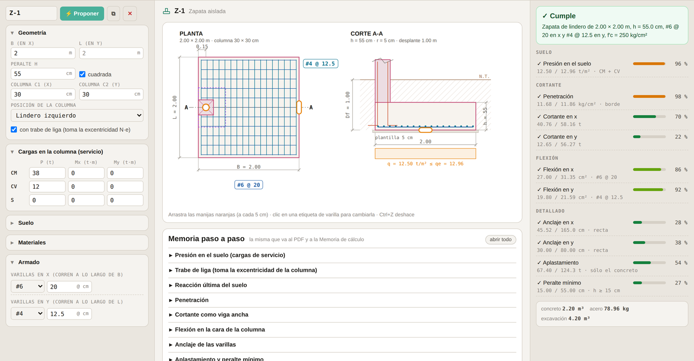
_Figura:_ **Zapata de lindero con trabe de liga.** A la izquierda el formulario; al centro el dibujo, que se arrastra, y la memoria; a la derecha las revisiones con su aprovechamiento.
1. **+ Nuevo** y el tipo. Arranca dimensionado y armado con cargas de ejemplo.
2. Captura las cargas de **servicio** por caso: CM, CV y S (sismo). En la zapata aislada, P, Mx, My y el cortante de la columna Vx, Vy; en la corrida, w y M por metro; en la contratrabe, P, M y V de cada columna.
3. **⚡ Proponer**: la base más chica que aguanta el suelo, el peralte más chico que pasa el concreto y la parrilla con menos acero que ancla, todo a cada 5 cm y vuelto a revisar con las varillas elegidas.
4. Ajusta lo que quieras en el formulario o en el dibujo; las revisiones se recalculan al momento.

### El armado: por separación o por cantidad

En cada parrilla hay dos campos juntos: la **separación** (con flechas ▲▼ a cada 5 cm) y la **cantidad** de varillas. Programas el que quieras; el otro se ve atenuado con lo que resulta (con la separación, cuántas varillas caben; con la cantidad, a cuánto quedan). Si programas la cantidad, se queda aunque cambies el ancho de la zapata. En las franjas por metro la cantidad es por metro.

### La contratrabe de liga de cada zapata (CT)

Toda zapata aislada, y la corrida bajo muro de mampostería, lleva **su** contratrabe de liga a la altura del tope del dado, con el lecho alto al nivel del terreno; ahí se une con las contratrabes de liga independientes (TL). Por omisión es la **CT-1** de la oficina: **15 × 30**, 4 varillas #4 (2 arriba y 2 abajo), estribos #2.5 @ 15, recubrimiento de 3 cm arriba y a los lados y de 5 cm abajo, contra el suelo. Sale en el corte de la zapata y en su detalle, y se revisa con lo que le toca:
- **Aislada:** la liga en tensión y compresión (10 % de la Pu), su peso y el muro que cargue en el claro libre a la zapata vecina (de RAM sale solo) y, si es de lindero o de esquina, el N·e. Como liga, estribos a no más de 1.5 b ni 20 cm; si trabaja como viga (N·e o cortante que el concreto no toma), a d/2.
- **Corrida bajo muro:** es la dala de desplante (NTC-Mampostería): tan ancha como el muro, As ≥ 0.2 f′c t²/fy con 3 varillas o más, estribos Asc ≥ 1000 s/(fy hc) a 1.5 t y 20 cm como máximo.

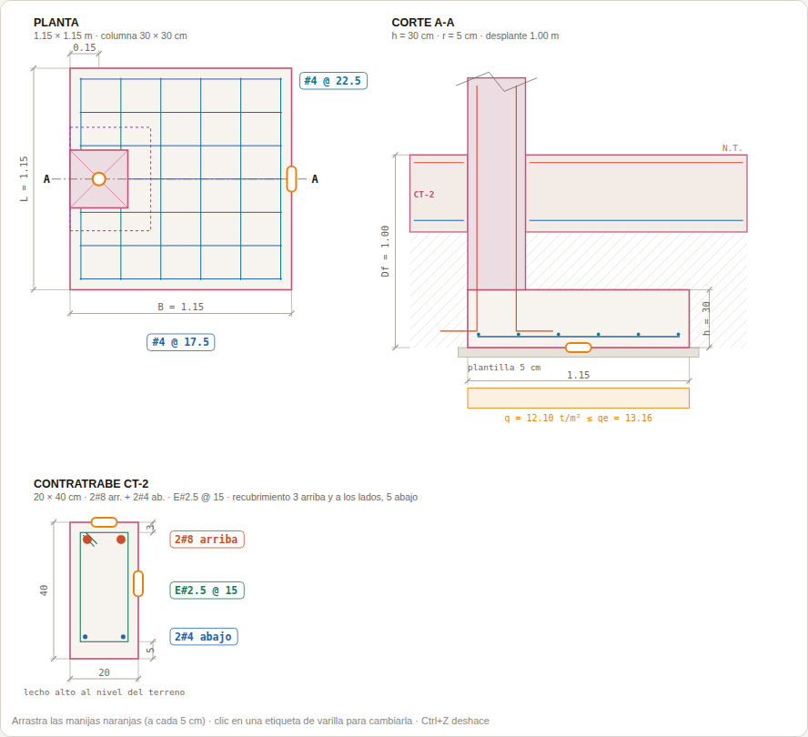
_Figura:_ **Zapata de lindero con su contratrabe de liga.** En el corte, la CT con el lecho alto al nivel del terreno; abajo, su detalle. Con el N·e de la columna de orilla la CT-1 no alcanza y ⚡ Proponer dejó una CT-2 de 20 × 40.
Si las solicitaciones piden otra, **⚡ Proponer** la diseña (se llama CT-2 mientras no le pongas otro nombre) y **volver a la CT-1** la regresa. Se edita en su bloque del formulario o en el detalle del dibujo.

### El dibujo se arrastra

- **Manijas naranjas**: cambian B, L, h, alturas, espesores, punta y talón, a cada 5 cm. Mientras arrastras, la escala no se mueve.
- **La columna** se arrastra: pegada a una orilla queda de **lindero**, a dos de **esquina**, al centro **céntrica**. En la contratrabe cada columna corre a lo largo del eje.
- **Clic en una etiqueta de varilla** (`#4 @ 20`) abre el selector de # y separación.
- `Ctrl`+`Z` deshace, igual que **↶ deshacer**. Cada cimiento se duplica o se borra desde su formulario.

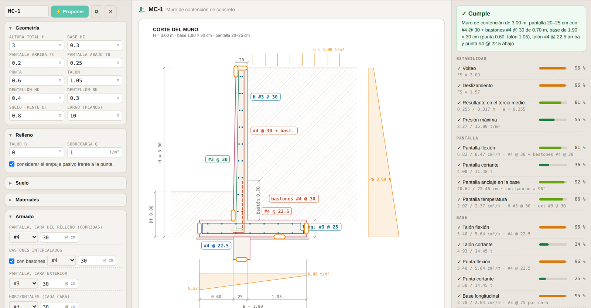
_Figura:_ **Muro de contención.** Empuje de Rankine con sobrecarga, bastones intercalados en la pantalla con su altura de corte, dentellón y la presión bajo la base.

### Los seis tipos

| Tipo | Qué revisa |
|---|---|
| **Zapata aislada** | Céntrica, de lindero o de esquina, con momentos. Suelo con el área efectiva B′ × L′; penetración con la sección crítica de 4, 3 o 2 lados y transferencia de momento; cortante como viga ancha; flexión en las cuatro caras; anclaje recto o con gancho; aplastamiento, con los arranques que hagan falta. En lindero o esquina, con **trabe de liga** (toma N·e y el suelo trabaja parejo) o sin ella. |
| **Zapata corrida** | Por metro, bajo muro de concreto (sección crítica en la cara) o de mampostería (a t/4 dentro del muro), al centro o de lindero. Suelo, cortante, flexión transversal, anclaje y el acero longitudinal de temperatura. |
| **Corrida con contratrabe** | Varias columnas sobre un eje, por el método rígido (presión lineal). Diagramas de cortante y momento de la contratrabe, armado abajo y arriba con los motores de la app, estribos, y los aleros como voladizos. **Centrar resultante** ajusta los voladizos para que la presión salga pareja. |
| **Muro de contención** | De concreto armado, en voladizo: volteo, deslizamiento (con dentellón y pasivo si lo pides), resultante en el tercio medio y presión máxima; pantalla, talón y punta a flexión y cortante; anclaje de la pantalla en la base; temperatura. |
| **Contratrabe de liga** | Une las zapatas de un eje a la altura del dado; no lleva zapata ni apoya en el suelo. Toma una fuerza de liga en tensión y compresión (10 % de la Pu de la columna más cargada del tramo), el momento N·e de las zapatas de lindero o de esquina que se ligan en ella (como viga de equilibrio) y el peso de un muro, si lo lleva. Flexión arriba y abajo, la tensión con el acero que sobra, compresión, cortante con estribos cerrados y sección mínima la CT-1 (15 × 30), de la que arranca ⚡ Proponer. Con el criterio del ACI 18.13.3.3 encendido, además lado ≥ claro/20 (sin pasar de 45 cm). |
| **Muro de piedra** | De gravedad, de piedra braza: la misma estabilidad, juntas sin tensión a cada altura, y compresión y cortante en la mampostería. ⚡ Proponer prueba también inclinar el frente. |
| **Cimiento de mampostería** | Trapecio o medio trapecio (lindero), como la hoja de la oficina: el ancho por suelo, el escarpio por cortante y a 1.5 del vuelo y, en lindero, la separación máxima de muros perpendiculares (tabla 8.4 de la NTC-Mampostería). |

### Desde las reacciones de RAM

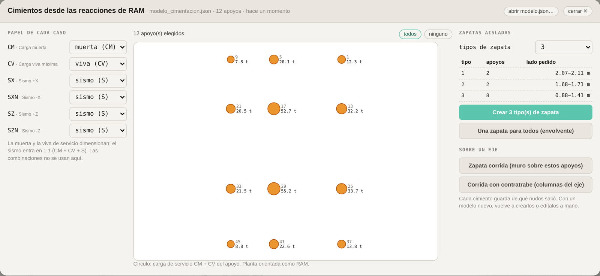
_Figura:_ **⚡ Desde RAM.** Los apoyos del modelo con su carga de servicio; doce columnas agrupadas en tres tipos de zapata por el ancho que pide cada una.
1. Sincroniza con un `sincronizar.py` actual: lee las reacciones de cada **caso de carga**. La ventana toma sola el último modelo; también puedes **abrir modelo.json…**.
2. Revisa el **papel de cada caso**: muerta (CM), viva (CV), sismo (S) o no usar. Sale del nombre del caso; cámbialo si tu modelo los llama distinto.
3. Elige apoyos en la planta: clic, `Mayús`+clic para sumar, o arrastra una ventana; **todos** y **ninguno**.
4. **Zapatas aisladas:** di cuántos tipos quieres; la app agrupa por el ancho que pide cada columna y la tabla dice cuántos apoyos van en cada tipo. **Crear** hace una zapata por tipo, con la envolvente de sus apoyos, o **una para todos**.
5. **Sobre un eje:** con los apoyos de una fila, **zapata corrida** (la carga por metro del muro) o **corrida con contratrabe** (cada columna con su P y su M, y el sismo en el sentido que más la voltea).

Cada cimiento guarda de qué nudos salió y lo dice arriba de su formulario. Una zapata tipo se revisa además con la reacción de **cada uno** de sus apoyos: la envolvente junta la P más pesada con el M más grande, pero con el sismo descargando puede mandar la columna ligera de la esquina. La columna de cada apoyo sale del modelo con su sección real.

### Sobre un eje: corridas, contratrabes y ligas

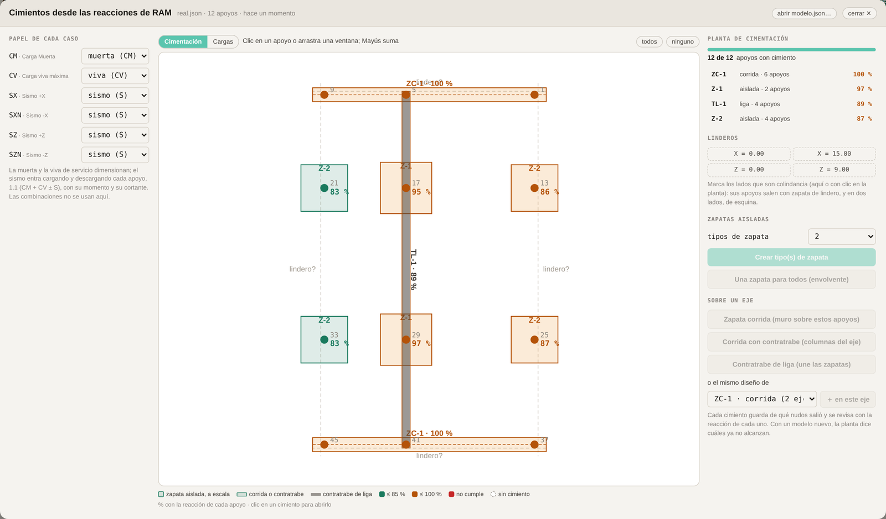
_Figura:_ **Sobre un eje.** ZC-1 es una sola corrida en dos ejes (X = 0 y X = 15), las interiores son aisladas y la contratrabe de liga TL-1 une las zapatas del eje de los nudos 5, 17, 29 y 41 a la altura del dado.
- **Zapata corrida** y **corrida con contratrabe**: con los apoyos de una fila. Terminan a 0.5 m de la última columna, o al ras si ese extremo cae en un lindero marcado.
- **Contratrabe de liga**: une las zapatas del eje por arriba, sobre los dados; no lleva zapata y no cuenta como cimiento de sus apoyos. Si alguna zapata del eje es de lindero o de esquina con trabe de liga, su N·e (a lo largo del eje) entra solo; si el eje corre paralelo al lindero, no.
- **El mismo diseño en otro eje**: elige los apoyos del otro eje y, en **o el mismo diseño de…**, la corrida, contratrabe o liga que ya tienes; **＋ en este eje** la agrega y la vuelve a proponer para que cumpla en todos. El formulario lista sus ejes (con ✕ para quitar uno), la memoria empieza con cómo queda cada eje y cada revisión dice cuál rige. Las cantidades suman todos los ejes.

### La planta de cimentación

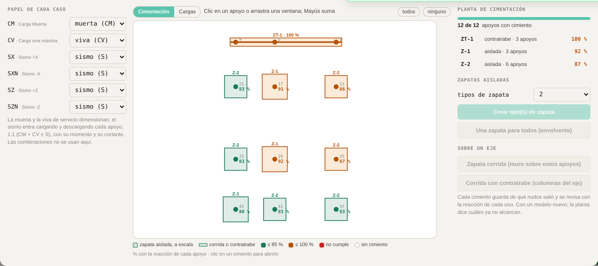
_Figura:_ **Cimentación.** El edificio de prueba: una contratrabe en el eje de los nudos 1, 5 y 9, y nueve zapatas en dos tipos. Cada apoyo con su % de utilización con su propia reacción; a la derecha, cuántos apoyos tienen cimiento y cada cimiento con su peor %.
Después de crear, la ventana se queda abierta en la vista **Cimentación** (la otra, **Cargas**, es la de antes): cada apoyo con su cimiento dibujado a escala, las aisladas como cuadros y las corridas y contratrabes como franjas sobre su eje.
- **Color y %:** la utilización del cimiento con la reacción de ese apoyo, lo más exigido de todas sus revisiones. Verde hasta 85 %, ámbar hasta 100 %, rojo si no cumple.
- **Sin cimiento:** círculo punteado. **elegir los que faltan** los selecciona para crearles el suyo.
- **En dos cimientos:** anillo rojo y aviso; borra el que sobre.
- **Clic en un cimiento** (en la planta o en la lista) lo abre.
- Los % se calculan con las reacciones del modelo de hoy: al resincronizar, la planta dice cuáles ya no alcanzan.

### Linderos: zapatas de lindero y de esquina

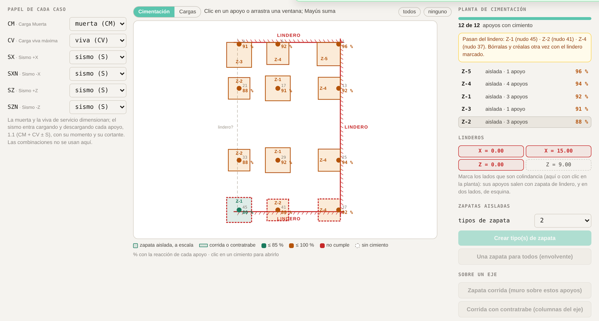
_Figura:_ **Linderos.** X = 0 y Z = 0 marcados antes de crear: sus zapatas salen de lindero, con la columna a la orilla y creciendo hacia adentro, y la del nudo 1 de esquina. Al marcar después X = 15, las céntricas de ese lado se marcan en rojo punteado: pasan del lindero.
1. Marca los lados de la planta que son colindancia: clic en el lado (la línea punteada que dice **lindero?**) o en su botón de **Linderos** (`X = 0.00`, `Z = 9.00`…, en los ejes del modelo). El lindero es el paño exterior de las columnas de ese lado.
2. Elige los apoyos y crea las zapatas como siempre. Los que caen sobre un lindero salen **de lindero**; sobre dos, **de esquina**; los demás, céntricas. Cada condición se agrupa en sus propios tipos; la tabla de tipos lo dice.
3. Revisa en la planta que ninguna diga que **pasa del lindero**. Si marcaste un lindero después de crear, borra las que avisa y créalas otra vez.

Cada zapata de lindero o de esquina se diseña en sus propios ejes, con la columna del lado −x (y −y en la esquina): la app gira o refleja las cargas de cada apoyo a esos ejes, así un mismo tipo sirve en los cuatro lados. Salen con **trabe de liga**, que toma el momento N·e; si tu estructura no la tiene, quítala en el formulario y vuelve a proponer. Una **corrida** sobre un lindero sale de lindero (el muro a la orilla); una **contratrabe** sobre un lindero se diseña centrada y lo avisa.

> Cargas El suelo se revisa con cargas de **servicio**: CM + CV y, con sismo, CM + CV ± S contra 1.33 qadm. El concreto, con cargas **últimas**: 1.3 CM + 1.5 CV y 1.1 (CM + CV ± S). El sismo va en los dos sentidos de su axial (carga y descarga la columna; la que descarga rige en las de orilla) y siempre agrandando los momentos. El cortante de la columna llega al desplante: M + V·h. La presión se informa como en la hoja, contra **qe = qadm − W/A** (W el peso de la zapata y del relleno); con excentricidad, e = (M + V h)/(N + W) y q = (N + W)/A′ − W/A, que es lo mismo que (N + W)/A′ ≤ qadm.

### Memoria y planos

- Al centro, **Memoria paso a paso**: cada revisión con su fórmula, la sustitución y el resultado. Es la misma que va al PDF y al Word.
- **📄 Memoria PDF** del cimiento seleccionado, o de **todos** con su tabla resumen, en `2 Salidas\Memoria`.
- **DXF** a escala real y por capas, de uno o de **todos**, y **SVG** del seleccionado, en `2 Salidas\Planos`.
- **Verificar → Memoria de cálculo**: el Word trae el capítulo de cimentación con el criterio, la tabla resumen y cada cimiento con su dibujo, sus revisiones y sus pasos.

> Cuando no hay cimiento que cumpla ⚡ Proponer se detiene en límites razonables (aislada hasta 10 m, corrida hasta 6 m, peralte hasta 2 m) y la revisión dice por qué no alcanza: un suelo muy pobre (conviene losa, pilas o mejorar el suelo), una columna chica para su carga (el aplastamiento no pasa ni con 4 % de arranques) o la resultante fuera de la base.

## 12. Los criterios de la app

Para saber qué está suponiendo la app cuando propone, y qué no revisa.

| Tema | Criterio |
|---|---|
| **Materiales** | f'c 250 kg/cm² y fy 4 200 kg/cm² para dimensionar la agrupación. Ec según NTC: clase 1 (f'c ≥ 250) 14 000√f'c con agregado calizo (11 000√f'c si es basáltico); clase 2 (200 ≤ f'c < 250) 8 000√f'c. |
| **Sección mínima de una trabe** (Agrupación) | Flexión: MR con ρ = ½ ρ balanceada, FR = 0.9, recubrimiento 3 cm; con eso se arma cómoda y es dúctil. Cortante: estribos #2.5 de dos ramas a no menos de 8 cm; si el acero de cortante pasa de FR · 1.1√f'c · b · d la separación máxima baja a d/4, y en poco peralte eso ya no se arma: pide peralte. Sin pasar del cortante máximo de la sección. |
| **Propuestas de agrupación** | Una clase sube a la sección del grupo de arriba si todas sus trabes caben y la más cargada la aprovecharía al menos al 50, 65 u 80 %. Sólo trabes horizontales; sólo secciones del catálogo con los anchos y peraltes permitidos. La sección se elige con la cuantía de dimensionamiento (½ ρ balanceada); el armado real lo pone después la verificación, que puede usar más acero (hasta 0.9 ρ balanceada) si hace falta. |
| **Sección mínima de una columna** (Agrupación) | El diagrama de interacción de cada sección con el armado de menos varillas entre 1.5 y 2.5 % de cuantía; P, Mx = \|M33\| y My = \|M22\| de la misma combinación, en el pie y la cabeza, con el contorno biaxial del módulo Columnas. Aprovechamiento: cuánto habría que crecer la demanda, P y M en la misma proporción, para llegar a la frontera. Mismos umbrales que las trabes; sólo columnas del catálogo y secciones permitidas. |
| **Armado de trabes** | El de menos acero que pasa con los motores de Longitudinal. Corridas por lecho: 3 si b ≤ 25 cm, 4 si b ≤ 35 cm, 5 si es mayor. Estribos #2.5 (o #3) de dos ramas. |
| **Armado de columnas** | Menos varillas primero; ρ de 1 a 4 %; separación c. a c. ≤ 20 cm; #4 o mayor si algún lado ≥ 20 cm. Flexocompresión con el diagrama de interacción de la app. |
| **Estribos de columna** | Centro y extremos según el capítulo 9, con H del modelo. |
| **Contratrabe de liga** | Práctica de la oficina, sin análisis de RAM: T = 10 % de la Pu mayor del tramo (ACI 18.13.3), N·e de las zapatas excéntricas con reparto lineal (viga de equilibrio), wu Ln²/10 con su peso y el muro; sección mínima la CT-1 (15 × 30), recubrimiento 3 cm arriba y a los lados y 5 abajo; estribos cerrados a d/2 ≤ 30 cm si trabaja como viga, a 1.5 b ≤ 20 cm si sólo liga (dalas, NTC-Mampostería); lado ≥ Ln/20 ≤ 45 cm sólo con el criterio del ACI 18.13.3.3. La CT de cada zapata, igual; en la corrida bajo muro, las reglas de las dalas (capítulo 11). |
| **Cimentaciones** | Las hojas de la oficina, corregidas. Suelo con cargas de servicio contra qe = qadm − γs (Df − h) − γc h, en t/m² (la hoja restaba t/m³ a kg/m²), con el área efectiva de Meyerhof B′ = B − 2e y e = (M + V h)/(N + W); con sismo, 1.33 qadm y el sismo cargando y descargando. Concreto con 1.3 CM + 1.5 CV y 1.1 (CM + CV + S): FR 0.9 en flexión y 0.75 en cortante; VcR = 0.5 FR b d √f'c (reducido si h > 70 cm); penetración FR (0.5 + γ) √f'c ≤ FR √f'c con la sección crítica de 4, 3 o 2 lados; aplastamiento FR 0.65, √(A2/A1) ≤ 2, y el excedente con arranques. Acero: el calculado, 4/3 de él o el mínimo, nunca menos que 0.0018 b h. Anclaje con Ld × As,req/As,prov (≥ 30 cm) o gancho a 90°. Muros: Rankine con talud, empuje × 1.5 para el concreto, FS de volteo 2.0 y de deslizamiento 1.5, resultante en el tercio medio. Mampostería: NTC-Mampostería, tabla 8.4 en linderos (capítulo 11). Mínimos de la oficina: ancho de zapata 0.60 m y desplante (o enterrado de un muro) 0.60 m. |
| **Deflexiones** | Con CS = 1·CM + 1·CV: elástica de RAM × IRAM/Ie (Branson, sección agrietada con el armado); diferida 2/(1 + 50ρ′) × inmediata de CS (clase 1); límites L/240 + 0.5 cm y L/480 + 0.3 cm, voladizos al doble (capítulo 10). |

> Lo que NO revisa
> - **Deflexiones al agrupar o al proponer armado**: ni la agrupación ni las propuestas las consideran; se revisan después, en el módulo Deflexiones, con las secciones ya creadas.
> - **Cortante y esbeltez en columnas**: ni la agrupación ni la propuesta de columnas los revisan todavía.
> - **Segunda iteración**: la agrupación usa las demandas del análisis con las secciones de hoy; por eso se aplica, se reanaliza y se vuelve a agrupar.
> - **Zona extrema de castillos** a la mitad: es criterio de la oficina, no de la norma.
> - **Cimentaciones**: asentamientos, losas de cimentación y pilas, ni la interacción suelo-estructura (la contratrabe usa el método rígido). La trabe de liga da su momento, pero se diseña en Secciones.

## 13. Problemas frecuentes

Casi todos tienen que ver con cómo se corrió el script o con la carpeta.

| Qué ves | Por qué | Qué hacer |
|---|---|---|
| `IndentationError` o `SyntaxError` en RAM | El script se pegó en el editor de la consola y se descompuso la sangría. | **Abrir Script…** → el archivo → `Ctrl`+`R`. Nunca pegado. |
| `'NoneType' object is not callable` | Dentro de RAM, Python no puede borrar archivos ni crear carpetas. Un script viejo lo intentaba. | Baja el script otra vez desde la app; los actuales ya no lo hacen. |
| `Section not found: "15 X 20"` | En esa computadora no está instalado el catálogo. | Corre **instalar_catalogo.py** (capítulo 2) y, si hace falta, reinicia RAM. |
| La app no encuentra el `modelo.json` | La ruta dentro de `sincronizar.py` no es la carpeta que elegiste en la app. | En **⚙ Configurar RAM** revisa la ruta, genera el script otra vez; o **olvidar carpeta** y elige la buena. |
| «no se pudo leer… ¿sólo en la nube?» | OneDrive tiene el archivo en la nube, no en la computadora. | Clic derecho en la carpeta → **Conservar siempre en este dispositivo**. |
| Demandas en cero, o las de antes | El modelo no se analizó después del último cambio. | Analiza en RAM y vuelve a correr `sincronizar.py`. |
| «medidas deducidas de los nombres» | El `sincronizar.py` es de una versión anterior. | Genera el script otra vez. |
| «Las demandas son de otra sección» | RAM analizó con otras medidas que las del proyecto. | Ver capítulo 4. Si dice «invertida», el error está en RAM. |
| Una trabe continua sale partida | En RAM sus tramos no comparten nudo o no son colineales. | Revísalo en la vista del modelo (Longitudinal) y corrige la geometría en RAM. |
| Un miembro que buscas en Agrupación no aparece | El buscador dice por qué: no existe, es columna, no es horizontal o su grupo no está marcado. | Si es su grupo, márcalo en **Qué agrupar**. |
| Guardar o exportar descargan en vez de ir a la carpeta | La obra no tiene carpeta configurada, o el navegador no dio permiso de edición. | Reportes de RAM → Sincronizar y acepta «editar archivos»; o genera el script otra vez eligiendo la carpeta. |
| «La carpeta ya tiene el proyecto X…» | Vas a guardar una obra encima de otra. | Cancela y revisa la ruta en Configurar RAM; si sí es la misma obra con otro nombre, acepta: la anterior queda en 3 Respaldos. |
| Deflexiones: «este modelo.json no trae desplazamientos» | El `sincronizar.py` es de una versión anterior. | Genera el script otra vez, córrelo y sincroniza. |
| Deflexiones: «? sin armado» | El proyecto no tiene esa sección. | Créala desde **Reportes de RAM**; mientras, sólo se ve la elástica de RAM, que se queda corta. |
| La planta de Agrupación no se parece a la de RAM | Se giró. | **↻ girar** hasta que diga `X↓ Z← · como RAM`. |
| El aplicar dice que falta una sección | No se aplicó la agrupación: falta el catálogo en esa computadora. | **instalar_catalogo.py**, reinicia RAM y vuelve a aplicar. Si además dice que un miembro «se quedó con» otra sección al probar, cierra el modelo sin guardar. |
| Cimentaciones → Desde RAM: el modelo no trae reacciones, o sólo por combinación | El `sincronizar.py` es de una versión anterior: sin los casos no se pueden separar CM, CV y S. | Genera el script otra vez, córrelo y sincroniza. |
| En AutoCAD, un texto del DXF sale con «?» en lugar de acentos | El DXF es de una versión anterior a la 3.05. | Expórtalo otra vez: los acentos van como `\U+00E9`, que AutoCAD convierte en la letra; «·» sale «-», «×» sale «x» y, como txt.shx no trae superíndices, m² sale m2 (desde la 3.06). |
| El instalador dice «No encontré la tabla de mampostería de RAM…» | Tu RAM no tiene las tablas Masonry clay / Masonry concrete donde se buscan. | Los concretos y secciones sí se instalaron. Manda la salida (lista las tablas que vio) para ajustar el instalador. |
| Un cimiento no cumple ni con ⚡ Proponer | Suelo muy pobre, columna chica para su carga o resultante fuera de la base. | Lee el aviso bajo el veredicto: dice qué no alcanza y qué conviene. |
| Agrupación → Columnas: «Este modelo.json es de un sincronizar.py anterior» | Las columnas no traen M22 ni las fuerzas de cada combinación. | Genera el script otra vez, córrelo y sincroniza. |

## 14. Práctica con el edificio de prueba

Para aprender el flujo completo sin tocar una obra: un script construye en RAM un edificio pequeño, todo en 15×20 y sin agrupar, como cuando se empieza a estructurar.

> El edificio 3 niveles de 3.0 m, rejilla de 3 × 2 crujías con claros distintos (X: 4.0, 6.5 y 4.5 m; Z: 5.5 y 3.5 m). 36 columnas `COL 30 X 30` con descripción C1; 21 trabes continuas de 15×20 sin descripción, cada crujía en 4 tramos (204 miembros); concreto F'C 250. Carga muerta y viva de losa por áreas tributarias, sismo estático en X y Z con sus dos signos, y las combinaciones de diseño. El script también lo analiza.

1. Pide `edificio_prueba.py` (está en `scripts/ram` del repositorio de la app). En RAM: **Archivo → Nuevo**; el script se niega a trabajar sobre un modelo que ya tenga algo.
2. **Abrir Script… → edificio_prueba.py → `Ctrl`+`R`.** Construye, carga y analiza. Si falta el catálogo, lo dice y no construye nada.
3. **Guardar como…** en una carpeta de prueba, por ejemplo `Escritorio\Prueba Auxiliar`; nunca en la de una obra.
4. En la app, un proyecto nuevo → **Reportes de RAM → Configurar RAM** → la ruta de esa carpeta → **Generar sincronizar.py**; elige la carpeta.
5. En RAM, **sincronizar.py**; en la app, **🔄 Sincronizar**. Llegan 204 miembros sin descripción y el grupo C1: a las columnas, **ahora no** por el momento.
6. **Módulos → Agrupación.** Quita el ancho de 15 cm, compara las tres propuestas, mira la planta y prueba el acomodo manual: por ejemplo, junta las trabes de fachada de los tres niveles en un grupo, o arrastra en la escala de aprovechamiento las trabes que quedan solas a la izquierda.
7. Cambia a **Columnas**: compara por entrepiso y con **misma sección en toda la altura**, y selecciona un grupo para ver sus puntos en el diagrama de interacción.
8. **⬇ aplicar_agrupacion.py** de trabes y, si quieres, el de columnas → en RAM **Abrir Script… → `Ctrl`+`R`** cada uno → reanaliza → sincroniza.
9. Ahora llegan T1…Tn y C1: **crear las secciones con su armado**. Revisa los ✓, ⚠ y ✗, abre Longitudinal, **Deflexiones** y la memoria.
10. Vuelve a Agrupación con las demandas nuevas: ¿siguen pasando los grupos? Ésa es la segunda iteración.

## 15. Referencia rápida

### Dónde queda cada cosa

| Qué | Dónde |
|---|---|
| Catálogo de secciones | C:\ProgramData\Bentley\Engineering\RAM Elements\26.0.1\Database\Sections\Personales\Vigas de Concreto.sec y Columnas de Concreto.sec |
| Catálogo de concretos | …\Database\Materials\Personales\Concreto.mat |
| Catálogo de mampostería | …\Database\Materials\Personales\Mampostería de barro.mat y Mampostería de concreto.mat |
| Respaldos del catálogo | Escritorio: `Respaldo RAM - …` |
| La carpeta de la app en cada obra | `PROCESO\Auxiliar IV` (la arma crear-proyectoiv.bat) |
| El proyecto y el modelo | `Auxiliar IV\proyecto.json` y `Auxiliar IV\modelo.json` |
| Deshacer una agrupación | `Auxiliar IV\1 Agrupación\Deshacer agrupación <fecha>.py` |
| Memoria, planos, Double Check | `Auxiliar IV\2 Salidas\…` (la memoria PDF de la cimentación en `Memoria`, sus DXF en `Planos`) |
| Suelo y criterios de la obra | Cimentaciones → **🪨 Suelo y criterios**; se guardan con el proyecto. |
| Versiones anteriores | `Auxiliar IV\3 Respaldos` |
| Acomodo manual en curso | El navegador (se recupera al volver con el mismo modelo) |

### Palabras que usa la app

| Palabra | Qué quiere decir |
|---|---|
| **Grupo** | Los miembros de RAM con la misma descripción. Cada grupo es una sección de la app. |
| **Trabe continua** | Tramos colineales y seguidos encadenados: una trabe, una sección. |
| **Sección mínima** | La de menos concreto del catálogo que le basta a una trabe. |
| **Aprovechamiento** | Demanda entre capacidad de dimensionamiento: en trabes, lo mayor de flexión y cortante; en columnas, qué tanto de su diagrama de interacción usa su punto más exigido. 100 % es justo. |
| **Entrepiso** | En Agrupación → Columnas: la columna entre dos niveles de trabes. E1 es el de abajo. |
| **Fuerzas simultáneas** | P, M22 y M33 de una misma combinación en un mismo punto de la columna; no el máximo de cada una por su lado. |
| **Armado propuesto** | El que pone la app al crear una sección; se marca hasta que lo edites. |
| **Tramo** | En Deflexiones: la parte de una trabe continua entre dos apoyos, o un voladizo. |
| **Ie** | Inercia efectiva de la sección agrietada (Branson), con el armado de la sección. |
| **qe** | Capacidad efectiva del suelo: qadm menos el relleno sobre el cimiento y su peso propio. Contra ella se compara la presión de las cargas. |
| **B′ (área efectiva)** | El ancho que de verdad apoya cuando la carga no cae al centro: B − 2e (Meyerhof). |
| **Estaciones** | Los puntos a lo largo de cada miembro donde RAM da resultados. |
| **sin nombre** | Los miembros sin descripción en RAM: todavía no agrupados. |

### Atajos

| `Ctrl`+`K` | Abrir un módulo desde cualquier lugar. |
|---|---|
| `Ctrl`+`R` (en RAM) | Correr el script abierto en la consola de Python. |
| `Mayús` + clic derecho | En el explorador de Windows: **Copiar como ruta**. |
| `Mayús` / `Ctrl` + clic, `Esc` | En la planta de Agrupación: sumar o quitar trabes, y limpiar. |
| `Ctrl`+`Z` | En Cimentaciones: deshacer (medidas, varillas, cimientos borrados). |
| `Enter` / `Mayús`+`Enter` | En el buscador de miembros de Agrupación: seleccionar su trabe, o sumarla. |
